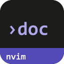
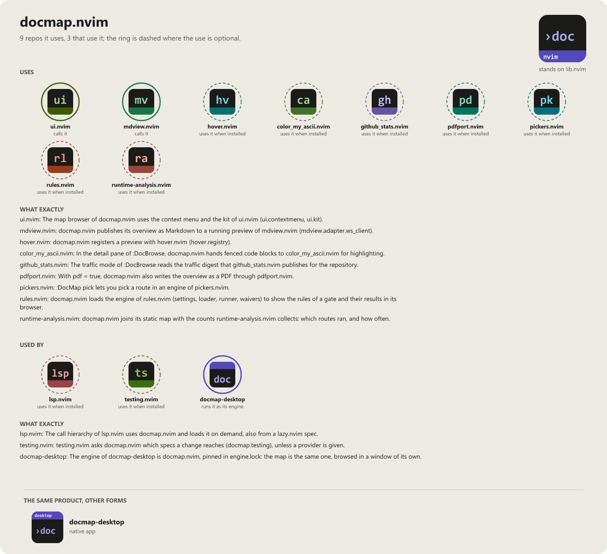

> **Beta stage — active development.** This repository is past its first shape and in
> active use, but the surface is not frozen: breaking changes are still possible. Pin a
> commit or tag if you depend on it.

# docmap.nvim

```
    _
 __| |___  __ _ __  __ _ _ __
/ _` / _ \/ _| '  \/ _` | '_ \
\__,_\___/\__|_|_|_\__,_| .__/
                        |_|
                        .nvim
```

[](LICENSE)
[](https://neovim.io)
[](https://www.lua.org)

[](https://github.com/WKDSteve/docmap.nvim/actions/workflows/ci.yml)
[](https://wkdsteve.github.io/wkd/p/docmap/)

> Part of the [wkd](https://wkdsteve.github.io/wkd/) family — see this plugin's [page](https://wkdsteve.github.io/wkd/p/docmap/) on the site.

> **know your project**

> **Renamed.** This plugin was `documentation.nvim` until 2026-10-24. The repository, the
> Lua namespace (`require("docmap")`, no compatibility shim) and the types (`Docmap.*`) changed
> with it; the commands (`:DocMap`, `:DocBrowse`), the standalone binary and `.docmap.json` did not.
> Existing plugin specs need the new repository name and `require("docmap").setup({})`.

Point it at a repository and it produces a **module map**: an interactive HTML
page, a Markdown overview, a deterministic JSON artifact, and a set of drift
checks that fail CI when the documentation and the code stop agreeing.

It reads **twenty-three languages** through one backend contract, so a tree that
mixes them comes out as one map rather than several.

---

## Documentation

**Start at [docs/README.md](docs/README.md)** — the folder's own index, grouped by
the question you arrived with. The four to reach for first:

| Page | Answers |
| --- | --- |
| [docs/pipeline.md](docs/pipeline.md) | Every stage, every design decision, and the measurement behind each one. **The document to read before changing anything.** |
| [docs/commands.md](docs/commands.md) | `:DocMap` and `:DocBrowse`, subcommand by subcommand |
| [docs/reuse.md](docs/reuse.md) | Generating a map for your own plugin — including the GitHub Action, which requires copying nothing |
| [docs/languages.md](docs/languages.md) | The twenty-three backends, as a reference and as a contract |

### Getting started

- [Requirements](docs/requirements.md) — Neovim version, `lib.nvim`, and what each optional integration buys you.
- [Installation](docs/installation.md) — every plugin manager, with the reason each needs a different lazy-loading shape.
- [Quickstart](docs/quickstart.md) — the first thing to run after installing.
- [What you get](docs/what-you-get.md) — the artifacts it writes, and how this repository's own published map shows what a consumer sees.
- [Around it](docs/around-it.md) — how this plugin's scope differs from its siblings in the collection.

### Configuration and everyday use

- [Configuration](docs/configuration.md) — every option, the `.docmap.json` precedence rules, and rebinding `:DocBrowse` by action rather than by key.
- [Tabs](docs/tabs.md) — what each panel of the generated page shows, and why.
- [Features](docs/FEATURES/README.md) — one page per area, with the reasoning behind each.
- [Lua API](docs/api.md) — `generate()`, `install()`, and the live `Docmap.Handle`.
- [MCP server](docs/mcp.md) — nine read-only tools over stdio, and why none of them writes.
- [Testing contract](docs/testing-contract.md) — which specs a change touches, from the require graph: freshness, explicit gaps, consumers in other repositories, and a "has specs" column in the map.
- [Integrations](docs/integrations.md) — the context-menu bridge for `nvzone/menu`.
- [Health](docs/health.md) — what `:checkhealth documentation` reports, including the declared external tools.
- [Bindings cheatsheet](docs/BINDINGS.md) — every keymap, user command and autocommand.
- [Workflow](docs/WORKFLOW.md) — which panel answers which question: Trail versus filter versus fuzzy jump.

### The rest

- [Ecosystem](docs/ecosystem.md) — how this plugin, `runtime-analysis.nvim`, `mdview.nvim` and `docmap-desktop` fit together.
- [Development](docs/DEVELOPMENT.md) — the toolchain, and the six things CI runs.
- [Contributing](docs/CONTRIBUTING.md) — ground rules, project layout, and how to add a language backend.
- [Feedback](https://github.com/WKDSteve/docmap.nvim/issues) — bugs, feature requests and usage questions.

`:help docmap.nvim` is the same ground in Vim help format.

---

## License

MIT — see [LICENSE](LICENSE).

<!-- connections:begin (written by the app-icons tool of the workshop; change integrations.json there, not this block) -->
## Connections



**Uses**

- [color_my_ascii.nvim](https://github.com/WKDSteve/color_my_ascii.nvim): In the detail pane of `:DocBrowse`, docmap.nvim hands fenced code blocks to color_my_ascii.nvim for highlighting. ([picture](assets/graphs/pair/docmap.nvim--color_my_ascii.nvim.png))
- [github_stats.nvim](https://github.com/WKDSteve/github_stats.nvim): The `traffic` mode of `:DocBrowse` reads the traffic digest that github_stats.nvim publishes for the repository. ([picture](assets/graphs/pair/docmap.nvim--github_stats.nvim.png))
- [hover.nvim](https://github.com/WKDSteve/hover.nvim): docmap.nvim registers a preview with hover.nvim (`hover.registry`). ([picture](assets/graphs/pair/docmap.nvim--hover.nvim.png))
- [mdview.nvim](https://github.com/WKDSteve/mdview.nvim): docmap.nvim publishes its overview as Markdown to a running preview of mdview.nvim (`mdview.adapter.ws_client`). ([picture](assets/graphs/pair/docmap.nvim--mdview.nvim.png))
- [pdfport.nvim](https://github.com/WKDSteve/pdfport.nvim): With `pdf = true`, docmap.nvim also writes the overview as a PDF through pdfport.nvim. ([picture](assets/graphs/pair/docmap.nvim--pdfport.nvim.png))
- [pickers.nvim](https://github.com/WKDSteve/pickers.nvim): `:DocMap pick` lets you pick a route in an engine of pickers.nvim. ([picture](assets/graphs/pair/docmap.nvim--pickers.nvim.png))
- [rules.nvim](https://github.com/WKDSteve/rules.nvim): docmap.nvim loads the engine of rules.nvim (settings, loader, runner, waivers) to show the rules of a gate and their results in its browser. ([picture](assets/graphs/pair/docmap.nvim--rules.nvim.png))
- [runtime-analysis.nvim](https://github.com/WKDSteve/runtime-analysis.nvim): docmap.nvim joins its static map with the counts runtime-analysis.nvim collects: which routes ran, and how often. ([picture](assets/graphs/pair/docmap.nvim--runtime-analysis.nvim.png))
- [ui.nvim](https://github.com/WKDSteve/ui.nvim): The map browser of docmap.nvim uses the context menu and the kit of ui.nvim (`ui.contextmenu`, `ui.kit`). ([picture](assets/graphs/pair/docmap.nvim--ui.nvim.png))
- [lib.nvim](https://github.com/WKDSteve/lib.nvim): the shared base of the plugins.

**Used by**

- [docmap-desktop](https://github.com/WKDSteve/docmap-desktop): The engine of docmap-desktop is docmap.nvim, pinned in `engine.lock`: the map is the same one, browsed in a window of its own. ([picture](assets/graphs/pair/docmap-desktop--docmap.nvim.png))
- [lsp.nvim](https://github.com/WKDSteve/lsp.nvim): The call hierarchy of lsp.nvim uses docmap.nvim and loads it on demand, also from a lazy.nvim spec. ([picture](assets/graphs/pair/lsp.nvim--docmap.nvim.png))
- [testing.nvim](https://github.com/WKDSteve/testing.nvim): testing.nvim asks docmap.nvim which specs a change reaches (`docmap.testing`), unless a provider is given. ([picture](assets/graphs/pair/testing.nvim--docmap.nvim.png))
<!-- connections:end -->
